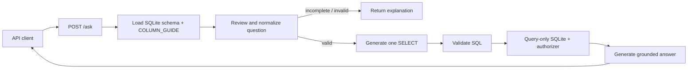

# Architecture

## Purpose

The desktop workspace sends a thread UUID and a run UUID to `POST /ag-ui`.
The Python `ag-ui-langgraph` adapter runs the same compiled LangGraph graph that uses
`InMemorySaver`. The `ag-ui-protocol` event encoder streams the adapter's run, node
and shared-state events over SSE. The browser shows progress as nodes run.

1. **Discover dashboards.** The model sees the six published entries with their IDs, titles,
   business purposes, supported questions, KPI labels, dimensions, keywords and qualified source names. It also receives office coverage and bounded thread context. Destination URLs, column definitions and SQL rows stay out of discovery.
   The catalogue is read from `app/dashboards.yml`. Entries accept only the published metadata fields. A schema block is a configuration error. Discovery never opens SQLite. The model ranks by
   intent and identifies a supporting KPI, exact or partial coverage and the reason.
   Nexora keeps the first three distinct entries that pass validation, in model order.
   An unavailable language service enables keyword fallback. A malformed ranking, refusal
   or rejected request produces a separate status. A valid empty ranking stays empty.
   For an ambiguous question the model can ask for one missing detail. The user supplies
   that detail when choosing Answer Here.
2. **Select sources.** Answer Here restores the original wording. The model sees table topics,
   approved relationship names and business context to choose a base and an ordered join path.
   An explicitly selected dashboard can guide the choice. An unselected recommendation supplies no default source. A question with no recommendation can
   still use available data. If discovery identifies an uncovered office in a validated recommendation,
   Answer Here asks for a covered office before source selection. Otherwise, the scope model
   identifies the required office filters for this turn. An uncovered office stops schema loading.
3. **Plan the query.** Only selected table definitions and join keys enter the planning request.
   Follow-ups carry the recent analyses, existing filters and outstanding clarification.
   Previously used sources supply compact column names and types. Newly required source
   definitions are validated and cached. Before SQL execution the server checks that the plan retains the positive office filters identified for the turn.
4. **Read evidence.** The application builds a bound SELECT for either a defined business
   metric or custom columns, aggregates, filters and sorting. A snapshot carries the answer,
   SQL, bindings and SQLite rows to the browser. Restoring a completed answer reruns its
   validated plan on the immutable fixtures. The browser can display a bar chart when
   the actual rows contain suitable labels and values.

Only the selected dashboard is writable client state, on the select action and after
validation against that thread's recommendations. The graph's request context holds
model inputs and transient evidence. The checkpoint keeps six recent questions and
analysis contexts and up to twelve run IDs and their actions for retries. The latest analysis
supplies the current plan. Each recommendation stores its rank by insertion order alongside
its coverage and reason in a single ordered mapping. Failure restores the last committed
checkpoint. The demo serialises turns in one process and retains up to 64 threads.

See the [Python AG-UI LangGraph adapter](https://github.com/ag-ui-protocol/ag-ui/blob/main/integrations/langgraph/python/README.md)
and [LangGraph persistence](https://docs.langchain.com/oss/python/langgraph/persistence).

## Stateless employee API

The application answers natural-language questions against the fixed SQLite
table `data` while keeping schema knowledge, prompts, orchestration, database
access, and presentation separate.

## Components

| Component | Responsibility |
| --- | --- |
| `static/` | Browser interface, result-shape inspection, and native charts |
| `app/api.py` | FastAPI routes, validation, and HTTP error mapping |
| `app/workflow.py` | LangGraph state, nodes, and routing |
| `prompts/` | Versioned question-review, SQL, and answer templates |
| `app/schema.py` | Fixed table name, column guide, examples, and eval cases |
| `app/database.py` | Existing-file validation, schema introspection, and guarded queries |
| `app/config.py` | Application and database settings |
| `app/llm_connection.py` | dotenv, provider validation, SDK lifecycle, Entra tokens, shared requests |

## Request flow

The workflow state is a `TypedDict` with three nodes. `review_question` loads
the cached schema and routes non-valid questions to the end. Valid questions
continue through `query_database`, which generates and safely executes SQL,
then `generate_answer`.

## Runtime sources of truth

- Environment values: process environment first, then project-root `.env` via python-dotenv
- Table contract: fixed table `data`, SQLite metadata, and `COLUMN_GUIDE`
- Prompt behavior: `prompts/*.yml`
- Workflow behavior: `app/workflow.py`

The stateless employee API exposes its fixed table's metadata through `GET /schema`.
Employee Workspace loads its five starter questions through `GET /conversation/examples`.

Chart eligibility is deterministic browser logic. It uses returned rows only,
does not add a model call, and leaves the `/ask` response contract unchanged.

## Boundaries

- FastAPI validates the question type and minimum length before the graph runs.
  There is no application maximum length or result-row cap.
- SQLite is opened in URI read-only mode and is never created or seeded here.
- Both providers use Chat Completions with system/user messages and strict JSON
  Schema. Pydantic validates responses in the workflow, outside connection code.
- Each workflow node owns a connection context and closes it after its model call.
  Callers may reuse a client for multiple requests within a context. There is no
  global cached client. Entra token acquisition/refresh uses the SDK callback.
- Generated SQL remains untrusted and passes through database guardrails.
- Each employee `/ask` request is stateless.

See the accepted [architecture decision](adr/0001-schema-guided-read-only-sql.md).
