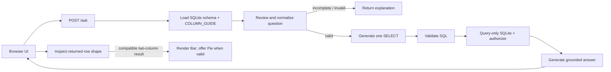

# Architecture

## Purpose

The default workspace discovers dashboards and answers questions across the
prebuilt demo sources. `POST /ag-ui` validates the current user action, runs a
checkpointed graph and streams a complete UI state snapshot. The browser stores
the thread UUID in session storage. Server state supplies the conversation context.

1. `read_dashboards` searches only `locations.dashboard_catalog` during discovery.
2. `handle_turn` restores the original question and selected dashboard for Answer Here.
3. `resolve_plan` resolves the measure, breakdown and filters. Standard demo
   questions and city comparisons resolve locally. Other wording goes through
   the existing provider connection with the relevant slice of the semantic catalogue.
   When discovery has no match, Answer Here also checks measure aliases such as
   “floor space”. An ambiguous or unknown subject prompts a clarification.
4. `analyse` builds a parameterised aggregate SELECT using approved joins. Live
   column definitions and keys are checked on first use and cached by table.
5. The API sends SQL, parameters, the metric definition, source names and rows in
   an AG-UI snapshot. The LangGraph checkpoint retains the compact plan and source names.
   A page reload reconstructs the latest evidence from the immutable fixtures.

The application uses ordinary LangGraph state channels, the public checkpointer
API and one lock for in-process turns. A failed turn restores the preceding
checkpoint. Each thread retains its six most recent questions, six compact analysis
contexts and twelve run IDs
for retries. A duplicate run synchronises to the current state.
See [AG-UI state snapshots](https://docs.ag-ui.com/concepts/state) and
[LangGraph persistence](https://docs.langchain.com/oss/python/langgraph/persistence).

## Employee assistant

The application answers natural-language questions against the fixed SQLite
table `data` while keeping schema knowledge, prompts, orchestration, database
access, and presentation separate.

## Components

| Component | Responsibility |
| --- | --- |
| `static/` | Browser interface, result-shape inspection, and native charts |
| `app/api.py` | FastAPI routes, validation, and HTTP error mapping |
| `app/workflow.py` | LangGraph state, nodes, and routing |
| `prompts/` | Versioned question-review, SQL, and answer templates |
| `app/schema.py` | Fixed table name, column guide, examples, and eval cases |
| `app/database.py` | Existing-file validation, schema introspection, and guarded queries |
| `app/config.py` | Application and database settings |
| `app/llm_connection.py` | dotenv, provider validation, SDK lifecycle, Entra tokens, shared requests |

## Request flow

The workflow state is a `TypedDict` with three nodes. `review_question` loads
the cached schema and routes non-valid questions to the end. Valid questions
continue through `query_database`, which generates and safely executes SQL,
then `generate_answer`.

## Runtime sources of truth

- Environment values: process environment first, then project-root `.env` via python-dotenv
- Table contract: fixed table `data`, SQLite metadata, and `COLUMN_GUIDE`
- Prompt behavior: `prompts/*.yml`
- Workflow behavior: `app/workflow.py`

The API exposes schema metadata to the frontend, which makes the UI independent
of the current table's column names.

Chart eligibility is deterministic browser logic. It uses returned rows only,
does not add a model call, and leaves the `/ask` response contract unchanged.

## Boundaries

- FastAPI validates the question type and minimum length before the graph runs.
  There is no application maximum length or result-row cap.
- SQLite is opened in URI read-only mode and is never created or seeded here.
- Both providers use Chat Completions with system/user messages and strict JSON
  Schema. Pydantic validates responses in the workflow, outside connection code.
- Each workflow node owns a connection context and closes it after its model call.
  Callers may reuse a client for multiple requests within a context. There is no
  global cached client. Entra token acquisition/refresh uses the SDK callback.
- Generated SQL remains untrusted and passes through database guardrails.
- Each employee `/ask` request is stateless.

See the accepted [architecture decision](adr/0001-schema-guided-read-only-sql.md).
